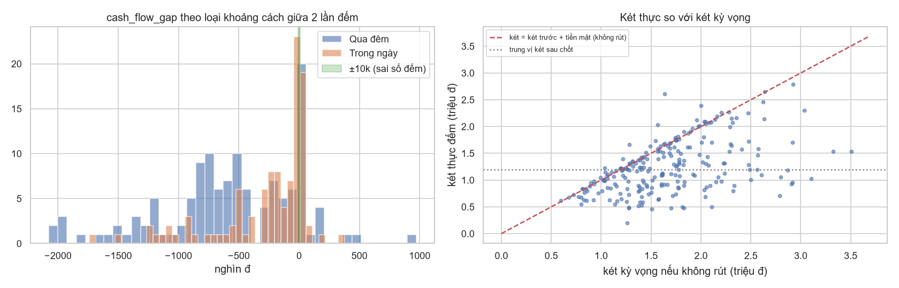
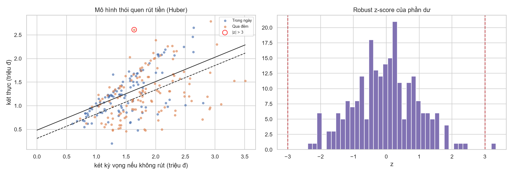
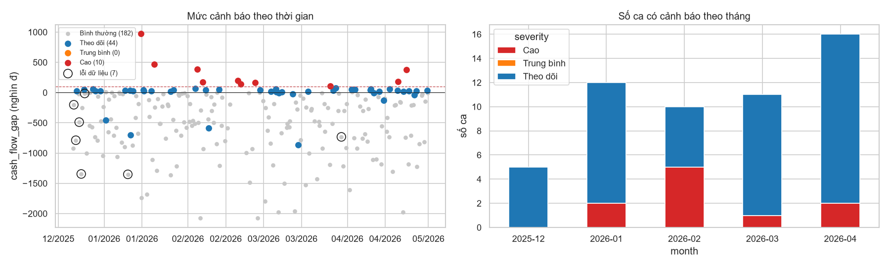

# Final Project – Khai phá dữ liệu vận hành POS với CRISP-DM và học máy không giám sát

Đồ án cuối kỳ nhóm 02 (Trần Hoàng Đạt, Võ Văn Minh, Nguyễn Trần Bảo Thái), viết theo format bài báo Tạp chí Khoa học ĐH Sư phạm TP.HCM.

| Phiên bản | Thư mục | Trạng thái |
|---|---|---|
| **v2 – làm lại (10/2026)** | [`notebook-v2/`](notebook-v2/) | ✅ Bản nên đọc. Dựng lại từ dữ liệu gốc sau khi phát hiện chỉ số lệch két của v1 đo sai |
| v1 – bản đã nộp (05/2026) | [`notebook-v1/`](notebook-v1/) | Giữ nguyên để đối chiếu (chỉ sửa notebook 02, xem [mục v1](#v1--bản-đã-nộp-và-các-kết-luận-sai)) |
| Báo cáo, slide, từ điển dữ liệu, quyết định thiết kế | [`docs/`](docs/) | Báo cáo/slide là bản nộp v1; [`DECISIONS.md`](docs/DECISIONS.md) giải thích các lựa chọn của v2 |

## Đóng góp và những gì làm được
**Đóng góp của đồ án**
1. **Bài toán và dữ liệu thật:** dữ liệu vận hành 5 tháng (236 ca, 5 412 hóa đơn) từ hệ thống POS do chính tác giả viết và triển khai thương mại cho một quán F&B, không phải dataset có sẵn.
2. **Chỉ số kiểm toán két đúng với cách quán vận hành:** dựng `cash_flow_gap` từ phương trình cân bằng két, tách được *tiền vào không có hóa đơn* (có căn cứ để cảnh báo) khỏi *tiền ra không ghi nhận* (không đủ căn cứ), và chỉ ra rõ giới hạn của dữ liệu.
3. **Quy trình kiểm tra dữ liệu trước khi mô hình hóa:** phát hiện lỗi đơn vị tiền két, nhãn ca sai, dòng "0 = không đếm", phép đối soát không độc lập, biến hằng số. Chính các lỗi này đã làm sai kết luận của bản v1.
4. **Gom tên khách tự động và ẩn danh:** chuẩn hóa ghi chú tiếng Việt viết tắt + phân cụm phân cấp, khớp bảng gom tay với ARI 0,99, không cần lưu tên khách trong code.
5. **Rule Engine minh bạch, không cần LLM:** 7 luật có căn cứ, tách lỗi dữ liệu khỏi cảnh báo nghiệp vụ, có bảng độ nhạy ngưỡng và báo cáo text tự động theo ca/tháng.
6. **Khuyến nghị vận hành cụ thể cho quán:** đếm két khi mở ca, ghi khoản rút/nạp vào POS, chặn nhập tiền két < 10.000 đ.

**Những gì làm được**

| Hạng mục | v1 (bản đã nộp) | v2 (làm lại) |
|---|---|---|
| Pipeline CRISP-DM 4 vòng, chạy lại được từ dữ liệu gốc | ✅ | ✅ |
| Kiểm tra và làm sạch dữ liệu | Một phần | ✅ 5 lỗi đơn vị, 2 nhãn sai, 3 dòng không đếm |
| Chỉ số lệch két phản ánh đúng thực tế | ❌ (97% ca "dư két") | ✅ `cash_flow_gap` |
| Phát hiện bất thường không giám sát | K-Means k = 4, DBSCAN, Ward | Huber + robust z, Isolation Forest 20 seed, K-Means có kiểm tra ổn định |
| Gom tên khách từ ghi chú | Bảng luật gõ tay | Tự động, ARI 0,99 so với bảng tay |
| Ẩn danh khách hàng | ❌ | ✅ KH01–KH12 |
| Rule Engine + báo cáo tự động | ✅ 3 luật (R1 không bao giờ kích hoạt) | ✅ 7 luật + độ nhạy ngưỡng + so sánh với v1 |
| Kết luận khớp số liệu | ❌ (kết luận viết cứng) | ✅ mọi nhận xét lấy từ output |
| Báo cáo dạng bài báo, slide, từ điển dữ liệu | ✅ | Dùng lại của v1, README này cập nhật kết quả mới |

**Người thực hiện**
- **v1:** nhóm 02 (Trần Hoàng Đạt, Võ Văn Minh, Nguyễn Trần Bảo Thái) cùng thực hiện và nộp 05/2026. Tác giả hệ thống POS và nguồn dữ liệu: Trần Hoàng Đạt.
- **v2:** Trần Hoàng Đạt làm lại sau khi nộp (10/2026).

## Đề bài
Dữ liệu thật từ một hệ thống POS (do tác giả tự viết và triển khai cho một quán F&B), 20/12/2025 – 30/04/2026, **không có nhãn** ca nào là gian lận. Câu hỏi:

1. Có phát hiện được các ca bất thường về tiền mặt bằng phương pháp **không giám sát** không?
2. Có nhận diện được khách quen từ ghi chú viết tắt của nhân viên để tìm đơn bất thường không?
3. Có tự sinh cảnh báo và khuyến nghị bằng **Rule Engine**, không cần LLM, không?

| File gốc | Số dòng | Nội dung |
|---|---|---|
| `MainLog.csv` | 242 | 236 lần chốt ca + 6 lần mở ca: doanh thu, tiền mặt, chuyển khoản theo máy, **tổng tiền đếm trong két** |
| `DetailsTransaction.csv` | 5 412 | Từng hóa đơn: thời điểm, tổng tiền, tiền mặt, chuyển khoản, ghi chú tự do (101 dòng có ghi chú) |

**Điều quan trọng nhất về dữ liệu:** `actual_cash_in_drawer` là **tổng tiền trong két** (gồm tiền tồn từ ca trước), và chủ quán **rút tiền khỏi két mà không ghi lại ở đâu**. Vì vậy chỉ có thể đo phần gộp:

$$\text{gap}_t = \text{két}_t - (\text{két}_{t-1} + \text{tiền mặt bán}_t) = \text{sai lệch}_t - \text{tiền rút}_t$$

- `gap < 0` (tiền ra): bình thường là chủ quán rút tiền, **không tách được** khỏi thất thoát.
- `gap > 0` (tiền vào): không ai rút tiền mà két lại tăng, nên đây là tín hiệu có căn cứ (đơn chưa nhập POS, thu nợ, nạp tiền lẻ, đếm sai).

## v2 — Cách làm
| Vòng | Notebook | Nội dung | Đầu ra |
|---|---|---|---|
| 1 – Kiểm tra dữ liệu | [01_data_audit.ipynb](notebook-v2/01_data_audit.ipynb) | Kiểm tra hóa đơn, dòng mở ca, nhãn ca theo giờ chốt, lỗi đơn vị tiền két (sửa ×1000); đối soát hóa đơn – chốt ca; tính `cash_flow_gap` theo phương trình cân bằng két | `shifts_v2.csv`, `bills_v2.csv` |
| 2 – Chẩn đoán | [02_cashflow_diagnostic.ipynb](notebook-v2/02_cashflow_diagnostic.ipynb) | Mô hình thói quen rút tiền (Huber regression + robust z); Isolation Forest 20 seed làm ý kiến thứ hai; K-Means chọn k theo Silhouette/DB/CH **và độ ổn định bootstrap**, đối chiếu Ward, GMM | `shifts_scored_v2.csv` |
| 3 – Khách quen | [03_customer_pattern.ipynb](notebook-v2/03_customer_pattern.ipynb) | Chuẩn hóa ghi chú (bỏ dấu, danh xưng, lỗi `n9`→`ng`); gom tự động bằng phân cụm phân cấp trên độ tương đồng chuỗi; **ẩn danh** KH01…; cờ lệch thói quen (≥ 5 đơn, thói quen ≥ 80%) | `customer_txn_v2.csv` |
| 4 – Rule Engine | [04_rule_engine.ipynb](notebook-v2/04_rule_engine.ipynb) | 7 luật (2 lỗi dữ liệu + 5 cảnh báo), bảng độ nhạy ngưỡng, so sánh với v1, báo cáo text theo ca và theo tháng | `rule_report_v2.csv`, [`04_rule_summary.md`](notebook-v2/outputs/04_rule_summary.md) |

| Mã | Luật | Điều kiện | Mức |
|---|---|---|---|
| DQ1 | Lỗi đơn vị tiền két | tiền két nhập < 10.000 đ | Lỗi dữ liệu |
| DQ2 | Nhãn ca sai | `is_morning_shift` không khớp giờ chốt | Lỗi dữ liệu |
| F1 | Tiền vào két không có hóa đơn (lớn) | `gap` > 100.000 đ | **Cao** |
| F2 | Tiền vào két không có hóa đơn (nhỏ) | 10.000 < `gap` ≤ 100.000 đ | Theo dõi |
| F3 | Két lệch khỏi thói quen rút tiền | \|robust z\| > 3 | Trung bình |
| C1 | Đơn khách quen lệch thói quen | lệch phương thức / giá trị cao bất thường | Theo dõi |
| C2 | Ghi chú có giao dịch tiền ngoài hóa đơn | cho mượn, trả nợ… | Theo dõi |

Lý do của từng lựa chọn: [docs/DECISIONS.md](docs/DECISIONS.md).

## v2 — Kết quả
**Vòng 1 – chất lượng dữ liệu**
- Hóa đơn sạch, chỉ 1 hóa đơn thiếu 8.000 đ. Đối soát hóa đơn – chốt ca khớp 100%, nhưng đó là vì POS tự cộng từ hóa đơn, **không phải kiểm tra độc lập**; `Payment_Mismatch` của v1 vì vậy luôn bằng 0.
- **5 ca** gõ tiền két theo đơn vị nghìn (480–1.270 đ), **2 ca** sai nhãn sáng/chiều, và chỉ có **6 dòng mở ca** cho 236 ca (3 dòng ghi 0 = không đếm).
- Dòng tiền: 174 ca tiền ra không ghi nhận (trung vị −250k), **44 ca tiền vào không rõ nguồn**, 18 ca khớp ±10k.

**Vòng 2 – chẩn đoán**
- Két được giữ quanh **1,2 triệu đ**; khoảng **một nửa** phần tiền tăng thêm bị rút ra. Lượng rút rất thất thường (MAD ≈ 435k), nên chỉ 1 ca lệch hẳn khỏi thói quen (z = +3,3).
- Isolation Forest đánh dấu 13 ca nhưng chủ yếu là **ca đông khách** (bắt quy mô, không bắt hành vi) → không dùng làm luật.
- Phân cụm: k = 5 (ổn định bootstrap 0,78; Silhouette ≈ 0,30 → cấu trúc cụm yếu). Cụm tách chủ yếu theo ca sáng/chiều và quy mô, chỉ dùng để mô tả.

**Vòng 3 – khách quen:** 45 cách viết → **12 khách**, gom tự động khớp bảng gom tay của v1 với **ARI 0,99**. 12 đơn lệch thói quen (v1: 21), vì v2 không đánh dấu khách vốn trả lẫn lộn.

**Vòng 4 – cảnh báo**

| Mức | Số ca | Nội dung |
|---|---|---|
| Cao | 10 | Tiền vào két > 100k không có hóa đơn (6 ca sáng, 4 ca chiều) |
| Theo dõi | 44 | Tiền vào nhỏ 10–100k (34 ca), đơn khách quen lệch thói quen, ghi chú tiền ngoài hóa đơn |
| Lỗi dữ liệu | 7 | 5 ca gõ sai đơn vị, 2 ca sai nhãn |
| Bình thường | 182 | |

- **Cả 11 ca** v1 kết luận "nghi thất thoát" đều không bị v2 cảnh báo: 5 ca là lỗi gõ đơn vị, 6 ca là tiền ra không ghi nhận (không đủ căn cứ).
- 6/10 ca mức Cao là ca sáng, nghĩa là tiền tăng **qua đêm**, có thể do chủ quán bỏ thêm tiền lẻ đầu ngày mà không ghi lại.

### So sánh v1 và v2
| | v1 (đã nộp) | v2 (làm lại) |
|---|---|---|
| Chỉ số lệch két | `két − tiền mặt ca`: 97% ca "dư", thực chất là tiền tồn két | `gap` theo phương trình cân bằng két, tách tiền vào / tiền ra |
| Lỗi nhập liệu | Không phát hiện; 5 ca gõ sai bị gọi là "thất thoát" | Phát hiện, sửa, báo riêng (DQ1, DQ2) |
| `Payment_Mismatch` | Đưa vào phân cụm và luật R1 dù luôn bằng 0 | Giải thích vì sao luôn bằng 0, bỏ |
| Chọn k | k = 4 dù chỉ số không ủng hộ | Chất lượng + độ ổn định bootstrap → k = 5, ghi rõ cụm yếu |
| Gom tên khách | Bảng luật gõ tay chứa tên khách | Phân cụm tự động (ARI 0,99 so với bảng tay), ẩn danh |
| Cảnh báo chính | 11 ca "nghi thất thoát" | 10 ca tiền vào không có hóa đơn + lỗi dữ liệu tách riêng |
| Ngưỡng | Cố định | Có bảng độ nhạy |

### Hạn chế còn lại của v2
- **Không phát hiện được thất thoát thật sự**: thiếu sổ ghi tiền rút/nạp và số đếm két lúc mở ca. Đây là giới hạn của dữ liệu, không phương pháp nào bù được.
- Không có nhãn thật hay xác nhận của chủ quán, nên không đo được precision của các cảnh báo.
- Ngưỡng 100k của F1 và |z| > 3 là lựa chọn hợp lý chứ không tối ưu; bảng độ nhạy cho thấy số ca thay đổi thế nào.
- Phân cụm có cấu trúc yếu; chỉ nên dùng để mô tả.

**Khuyến nghị cho quán (giá trị thực tế nhất của đồ án):** bắt buộc đếm két khi mở ca, ghi mọi khoản rút/nạp vào POS, và chặn nhập tiền két < 10.000 đ. Chỉ cần vậy là `gap` trở thành sai lệch thật và Rule Engine có thể phát hiện thất thoát.

## v1 — Bản đã nộp và các kết luận sai
Bản v1 được chấm điểm tối đa, nhưng xem lại thì có những vấn đề sau (đều đã được xử lý trong v2):

1. **Kết luận viết cứng không khớp số liệu (đã sửa trong notebook 02).** Phần nhận xét cuối viết *"ARI cao"* và *"cả 3 thuật toán xác nhận k = 4 là lựa chọn vững chắc"*, trong khi ARI giữa K-Means và Ward chỉ 0,305 và DBSCAN chỉ tìm được 1 cụm. Ô đối chiếu DBSCAN–C0 bị bỏ qua vì gọi biến `df_audit` không tồn tại. Sau khi sửa: C0 đúng là ngoại lai (2/2 ca trùng điểm nhiễu DBSCAN), nhưng ranh giới C1–C3 phụ thuộc thuật toán. Báo cáo và slide đã nộp vẫn giữ cách diễn giải cũ.
2. **`Cash_Diff` đo sai thứ cần đo.** `Cash_Diff = két − tiền mặt ca` bỏ qua tiền tồn két và tiền rút, nên 97% ca bị tính là "dư két" và các cụm C1–C3 phản ánh mức tiền tồn két hơn là sai lệch.
3. **5/11 ca "nghi thất thoát" là lỗi gõ đơn vị tiền két** (480 đ, 490 đ, 860 đ, 1.230 đ, 1.270 đ).
4. **`Payment_Mismatch` luôn bằng 0** nhưng vẫn được đưa vào phân cụm, và rule R1 không bao giờ kích hoạt.
5. **k = 4 đi ngược các chỉ số** (Silhouette tốt nhất ở k = 2, Calinski-Harabasz ở k = 3); cụm C0 chỉ có 2 ca.
6. "Fuzzy grouping" thực chất là bảng luật gõ tay chứa tên khách; output notebook có tên khách và số tiền từng đơn; bài báo dùng các cụm như "giải quyết triệt để", "triển khai trên thiết bị biên" mà không có thực nghiệm chứng minh.

| Notebook v1 | Nội dung |
|---|---|
| [01_descriptive.ipynb](notebook-v1/01_descriptive.ipynb) | Ghép hóa đơn vào ca, tạo `Cash_Diff`, `Payment_Mismatch`, EDA |
| [02_diagnostic.ipynb](notebook-v1/02_diagnostic.ipynb) | K-Means k = 4, DBSCAN, Ward, hồ sơ cụm |
| [03_customer_pattern.ipynb](notebook-v1/03_customer_pattern.ipynb) | Chuẩn hóa ghi chú, gom khách bằng bảng luật |
| [04_prescriptive.ipynb](notebook-v1/04_prescriptive.ipynb) | Rule Engine R1–R3, báo cáo text |

## Kiến thức cần nhớ
- **Hiểu ý nghĩa từng cột trước khi tạo feature.** Một công thức thiếu (quên tiền tồn két, quên tiền rút) làm sai toàn bộ kết luận phía sau dù mô hình chạy đúng.
- **Phương trình cân bằng** (`số dư cuối = số dư đầu + vào − ra`) là công cụ cơ bản để kiểm toán dòng tiền; phần không cân bằng chỉ có ý nghĩa khi mọi khoản vào/ra đều được ghi.
- **Kiểm tra dữ liệu trước khi mô hình hóa:** lỗi đơn vị, nhãn sai, giá trị 0 nghĩa là "không đo", biến hằng số.
- **Đối soát chỉ có giá trị khi hai nguồn độc lập.** Tổng hóa đơn khớp số chốt ca chỉ chứng minh phần mềm cộng đúng.
- **Huber regression** + **robust z (MAD)**: phát hiện ngoại lai mà không để chính ngoại lai kéo lệch mô hình.
- **Isolation Forest** bắt điểm hiếm trong không gian feature, kể cả khi "hiếm" chỉ là "lớn"; phải xem các điểm bị đánh dấu trước khi dùng.
- **Chọn k:** ngoài Silhouette/DB/CH, kiểm tra **độ ổn định bootstrap** (ARI giữa các lần phân cụm trên mẫu lặp). Silhouette thấp ở mọi k nghĩa là dữ liệu không có cụm rõ.
- **Gom chuỗi gần đúng:** chuẩn hóa (bỏ dấu, danh xưng, lỗi gõ) + `SequenceMatcher` + phân cụm phân cấp; ngưỡng độ giống 0,6 là mặc định của `difflib.get_close_matches`.
- **Thói quen** chỉ có nghĩa khi đủ mẫu (≥ 5 đơn) và đủ rõ (≥ 80%); nếu không sẽ báo động giả.
- **Ẩn danh** dữ liệu khách ngay khi không còn cần tên thật.

## Chạy
Dữ liệu là dữ liệu kinh doanh thật nên **không có trên GitHub**, xem [data/README.md](data/README.md). Các notebook đã có sẵn output; hình và báo cáo tổng hợp (đã ẩn danh) nằm ở [`notebook-v2/outputs/`](notebook-v2/outputs/).

**v2:** đặt `MainLog.csv`, `DetailsTransaction.csv` vào `data/raw/`, mở các notebook trong `notebook-v2/` (thư mục làm việc là `notebook-v2/`) và chạy lần lượt 01 → 04. Kết quả trung gian ghi vào `data/processed_v2/`. Notebook 03 và 04 tự đối chiếu với kết quả v1 nếu `data/processed/` còn file của v1. Toàn bộ chạy dưới 1 phút trên CPU, cần thêm `scikit-learn`, `scipy`, `jinja2`.

**v1:** mở các notebook trong `notebook-v1/` và chạy 01 → 04; đầu vào đọc từ `data/raw/`, kết quả ghi vào `data/processed/`.
