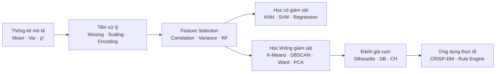

# ⛏️ Data Mining (Khai thác dữ liệu và ứng dụng)

Môn học tại ĐH Sư phạm TP.HCM, năm học 2025–2026, GVHD TS. Nguyễn Tấn Trung. Nhóm: Trần Hoàng Đạt, Võ Văn Minh, Nguyễn Trần Bảo Thái.

| Phần | Chủ đề | Kết quả nổi bật |
|---|---|---|
| [Weekend Lab](Weekend-Lab/) | Bài tập thực hành cuối tuần: thống kê & chuẩn hóa, KNN/Regression, clustering Pokemon | Clustering 50 Pokemon: Silhouette 0.35 → **0.48** sau PCA |
| [Final Lab](Final-Lab/) | Tiền xử lý 4 loại dữ liệu: ảnh, bảng, văn bản, chuỗi thời gian | Credit Card Fraud: recall lớp gian lận **0.91–0.92** sau under-sampling |
| [Final Project](Final-Project/) | Khai phá dữ liệu POS thực tế theo CRISP-DM: phát hiện rủi ro lệch két | Bản làm lại (v2): 236 ca → **10 ca tiền vào két không có hóa đơn**, 7 lỗi dữ liệu; cả 11 ca "nghi thất thoát" của bản đã nộp hóa ra là lỗi nhập liệu hoặc không đủ căn cứ |

## Lộ trình kiến thức


## Chạy
Mỗi phần có README riêng hướng dẫn tải dữ liệu. Ngoài `requirements.txt` ở gốc repo, các notebook cần thêm:

```bash
pip install scipy requests imbalanced-learn nltk yfinance kaggle kagglehub opencv-contrib-python
```

Final Lab được viết để chạy trên **Google Colab** (tự tải dataset từ Kaggle). Weekend Lab và Final Project chạy được trên máy.
