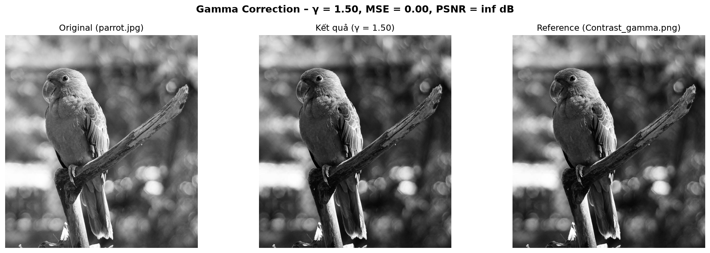
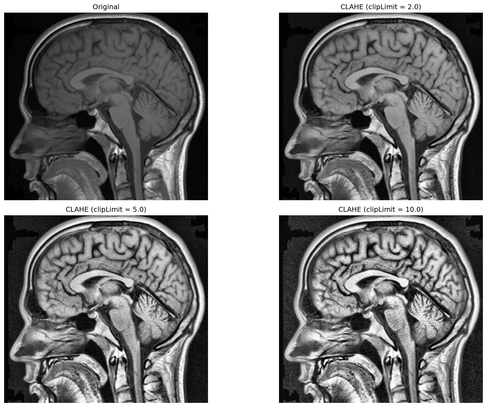

# Lab 02 – Gamma Correction & Histogram Equalization (HE / AHE / CLAHE)

## Đề bài
1. **Gamma correction:** từ `parrot.jpg`, tạo ảnh giống `Contrast_gamma.png` nhất có thể + tính PSNR.
2. **Histogram** trên `brain.jpg`:
   - a. Hiển thị histogram
   - b. Histogram Equalization
   - c. Adaptive HE: ít nhất 2 tùy chọn (window size / method)
   - d. CLAHE: ít nhất 2 giá trị `clipLimit`

Gợi ý: `cv2.calcHist`, `cv2.equalizeHist`, `cv2.createCLAHE(clipLimit, tileGridSize)`.

## Cách làm & kết quả
| Câu | Cách làm | Kết quả |
|---|---|---|
| 1 | Gamma qua bảng tra (LUT) có làm tròn. Quét γ thô (0.1 → 2.5, bước 0.1) rồi mịn (±0.1, bước 0.01), chọn PSNR lớn nhất | **γ = 1.50 → MSE = 0, PSNR = ∞** (trùng khớp tuyệt đối ảnh tham chiếu) |
| 2a | `cv2.calcHist` | [Q2a_histogram.png](outputs/Q2a_histogram.png) |
| 2b | `cv2.equalizeHist` | [Q2b_hist_equalization.png](outputs/Q2b_hist_equalization.png) |
| 2c | AHE = CLAHE với `clipLimit` rất lớn (40), `tileGridSize` 8×8 và 16×16 | [Q2c_adaptive_hist_eq.png](outputs/Q2c_adaptive_hist_eq.png) |
| 2d | CLAHE `clipLimit` = 2, 5, 10 (tile 8×8) | [Q2d_clahe.png](outputs/Q2d_clahe.png) |

> 🧭 Vì sao làm như vậy và các điểm cần lưu ý: xem [DECISIONS.md](DECISIONS.md)

## Kiến thức cần nhớ
- **Gamma:** `s = 255 · (r/255)^γ`. γ < 1 làm sáng vùng tối; γ > 1 làm tối, tăng tương phản vùng sáng. Cài bằng **LUT** 256 phần tử: nhanh và chính xác.
- **PSNR** = `10·log10(255² / MSE)` (dB): càng cao càng giống ảnh tham chiếu; MSE = 0 thì PSNR = ∞.
- **HE toàn cục:** dùng CDF của histogram để kéo giãn mức xám → tăng tương phản nhưng dễ cháy sáng, khuếch đại nhiễu.
- **AHE:** cân bằng theo từng ô (tile) → giữ chi tiết cục bộ, nhưng khuếch đại nhiễu ở vùng đồng nhất.
- **CLAHE:** AHE + giới hạn chiều cao histogram (`clipLimit`) trước khi tính CDF → hạn chế khuếch đại nhiễu. `clipLimit` càng lớn càng gần AHE.

## Chạy
Mở [lab02_histogram_gamma_clahe.ipynb](lab02_histogram_gamma_clahe.ipynb) (Jupyter / VS Code) – notebook đã có sẵn output, xem được ngay trên GitHub. Muốn chạy lại: đặt dữ liệu vào `data/` (xem [data/README.md](data/README.md)) rồi **Run All**; hình và bảng kết quả được lưu vào `outputs/`.

Cuối notebook có phần **Luyện tập thêm** (không thuộc yêu cầu lab): không gian màu, biến đổi log/gamma, histogram matching, nội suy khi phóng to.
