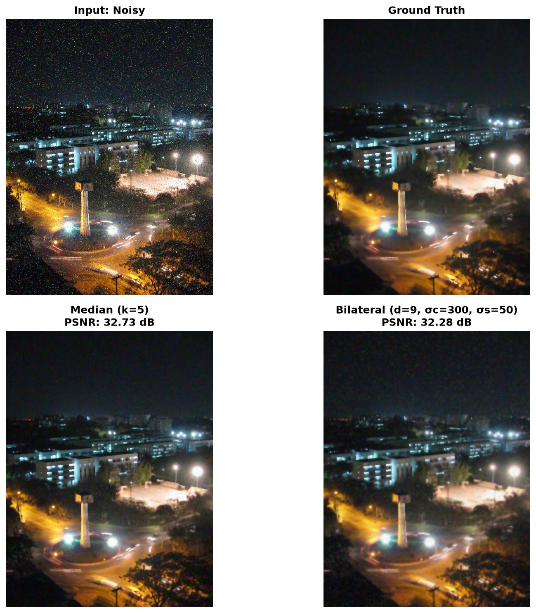
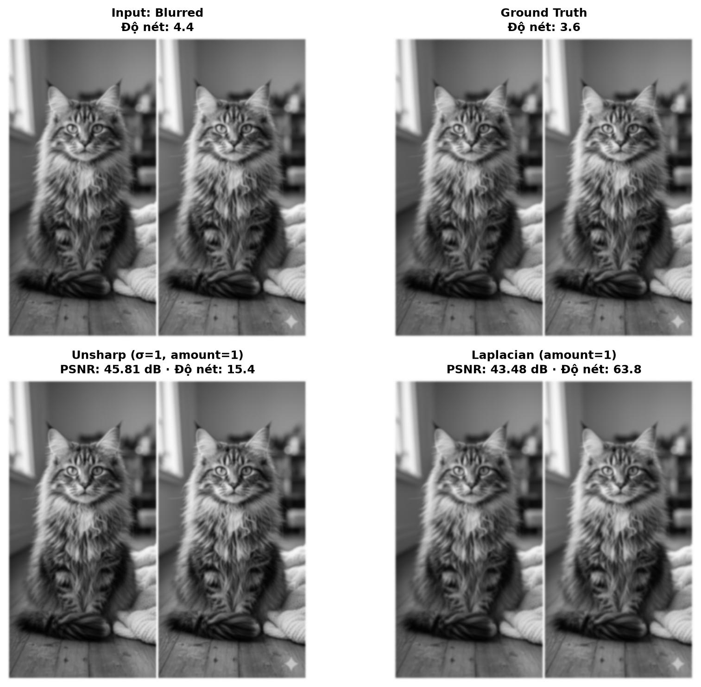
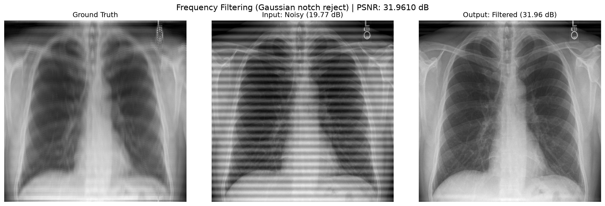

# Lab 03 – Lọc ảnh: Khử nhiễu, Làm nét, Lọc miền tần số

## Đề bài
| # | Yêu cầu | Input | Output |
|---|---|---|---|
| 1 | **Denoise**: dùng ít nhất 2 bộ lọc (Median, Bilateral, Non-local Means) | `city_noised.jpg` | ảnh khử nhiễu + PSNR |
| 2 | **Sharpening**: Unsharp masking + 1 bộ lọc khác | `cat_blurred.jpg` | ảnh làm nét + PSNR |
| 3 | **Frequency filtering**: band-stop (Ideal/Gaussian) | `xray_noisy.jpg` | ảnh đã lọc + PSNR |

Các file `city_denoised.jpg`, `cat_sharpened.jpg`, `xray_filtered.jpg` trong `data/` là **ảnh chuẩn (ground truth)** để tính PSNR.

## Kết quả
| Bài | Phương pháp | Tham số | PSNR |
|---|---|---|---|
| 1 | Median filter | kernel 5 | **32.73 dB** |
| 1 | Bilateral filter | d=9, σ_color=300, σ_space=50 | 32.28 dB |
| 2 | Unsharp masking | Gaussian 5×5, σ=1, amount=1 | 45.81 dB · độ nét 4.4 → **15.4** |
| 2 | Laplacian sharpening | kernel 4-connected, amount=1 | 43.48 dB · độ nét 4.4 → **63.8** |
| 3 | Gaussian notch reject (FFT) | D0=25, W=5 | **31.96 dB** (ảnh nhiễu: 19.77 dB) |

"Độ nét" = phương sai của Laplacian (độ đo không cần ảnh tham chiếu). Xem [DECISIONS.md](DECISIONS.md) để biết vì sao bài 2 cần thêm độ đo này.

> 🧭 Vì sao làm như vậy, kiểm chứng tham số và các điểm cần lưu ý: xem [DECISIONS.md](DECISIONS.md)

## Kiến thức cần nhớ
- **Median:** tốt cho nhiễu xung (muối tiêu), giữ cạnh tốt hơn lọc trung bình.
- **Bilateral:** làm mượt nhưng giữ biên; trọng số theo cả khoảng cách không gian (σ_space) lẫn chênh lệch cường độ (σ_color).
- **Non-local Means:** trung bình các patch giống nhau trên toàn ảnh, chất lượng cao nhưng chậm.
- **Unsharp masking:** `sharp = img + amount·(img − blur(img))`, tính bằng **float**.
- **Laplacian:** đạo hàm bậc 2 làm nổi biên: `sharp = img − amount·∇²img` (kernel tâm dương).
- **Lọc miền tần số:** `FFT → fftshift → nhân mặt nạ H(u,v) → ifftshift → iFFT`. Nhiễu tuần hoàn hiện thành **cặp điểm sáng đối xứng** trong phổ.
- **Band-reject** chặn cả một vòng tần số; **notch reject** chặn các điểm cụ thể. Dạng Gaussian chuyển tiếp mượt hơn Ideal, ít hiện tượng ringing.
- **PSNR chỉ có ý nghĩa khi ảnh chuẩn đáng tin.** Cần kiểm tra PSNR của ảnh input so với ground truth trước khi dùng nó để chọn tham số.

## Chạy
Mở [lab03_filtering.ipynb](lab03_filtering.ipynb) (Jupyter / VS Code) – notebook đã có sẵn output, xem được ngay trên GitHub. Muốn chạy lại: đặt dữ liệu vào `data/` (xem [data/README.md](data/README.md)) rồi **Run All**; hình và bảng kết quả được lưu vào `outputs/`.
