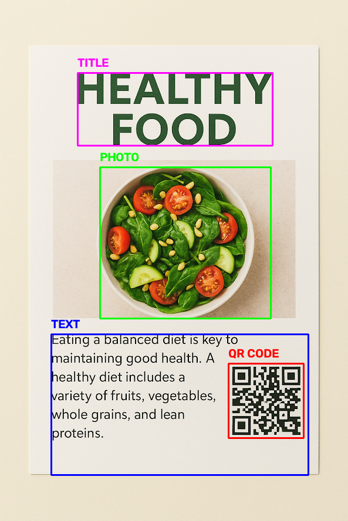

# Lab 04 (Final) – Phân đoạn tài liệu bằng Otsu + Morphology

## Đề bài (nộp 1 PDF: output + ảnh chụp code)
- **Input:** `data/document.png` (trang tài liệu có tiêu đề, đoạn văn, ảnh và QR code)
- **Output:** ảnh có bounding box cho từng vùng. Ảnh mẫu của giảng viên: `data/reference_output.png` (“chưa tốt nhưng chấp nhận được – cố gắng làm tốt hơn”).

Các bước gợi ý:
1. Input → Grayscale → Binary (**Otsu threshold**)
2. Phát hiện QR: `cv2.QRCodeDetector().detectAndDecode(gray)` → `qrcode_mask`
3. Xóa vùng QR khỏi ảnh nhị phân: `cv2.subtract(binary, qrcode_mask)`
4. Tách vùng **ảnh (photo)** bằng morphology: `getStructuringElement` + `morphologyEx` + `findContours` (kích thước SE và số vòng lặp rất quan trọng)
5. Tách vùng **text**: `subtract(binary, photo_mask)` rồi `subtract(text_mask, qrcode_mask)`
6. Vẽ bounding box

## Điểm nổi bật của bài làm
Phần lớn các thuật toán được **tự cài đặt bằng NumPy** (“scratch”) thay vì gọi OpenCV: Otsu threshold, dilate/erode/closing, structuring element, tìm contour, bounding rect, bitwise. OpenCV chỉ dùng cho đọc/ghi ảnh, QR detector và vẽ.

| Hàm | Kết quả |
|---|---|
| `segment_full_document_scratch` | [output_1_full_segmentation.png](outputs/output_1_full_segmentation.png) – box TITLE / PHOTO / TEXT / QR CODE |
| `segment_text_content_only_scratch` | [output_2_text_content_only.png](outputs/output_2_text_content_only.png) |
| `segment_text_and_title_scratch` | [output_2_text_and_title_only.png](outputs/output_2_text_and_title_only.png) |
| `segment_photo_only_scratch` | [output_3_photo_only.png](outputs/output_3_photo_only.png) |
| `segment_qrcode_only_scratch` | [output_4_qrcode_only.png](outputs/output_4_qrcode_only.png) |

> 🧭 Vì sao làm như vậy, kiểm chứng tham số và các điểm cần lưu ý: xem [DECISIONS.md](DECISIONS.md)

## Kiến thức cần nhớ
- **Otsu:** chọn ngưỡng `t` tối đa hóa phương sai giữa 2 lớp `σ_B²(t) = ω0·ω1·(μ0 − μ1)²` → không cần chọn ngưỡng tay.
- **Dilation** (max lân cận) nở vùng trắng; **Erosion** (min lân cận) co vùng trắng.
- **Closing** = dilate → erode: lấp lỗ/khe nhỏ, nối các ký tự thành khối (dùng gom chữ thành đoạn).
- **Opening** = erode → dilate: xóa đốm nhiễu nhỏ.
- SE hình chữ nhật **ngang** (vd 40×3) gom chữ theo dòng; SE lớn (15×15, 50×50) gom thành khối ảnh.
- Lọc contour theo **diện tích, tỉ lệ khung, vị trí** để phân biệt vùng ảnh / chữ / tiêu đề.

## Chạy
Mở [lab04_otsu_morphology_segmentation.ipynb](lab04_otsu_morphology_segmentation.ipynb) (Jupyter / VS Code) – notebook đã có sẵn output, xem được ngay trên GitHub. Muốn chạy lại: đặt dữ liệu vào `data/` (xem [data/README.md](data/README.md)) rồi **Run All**; hình và bảng kết quả được lưu vào `outputs/`.

Chạy toàn bộ mất khoảng 1 phút vì morphology và tìm contour được tự cài bằng vòng lặp Python.
